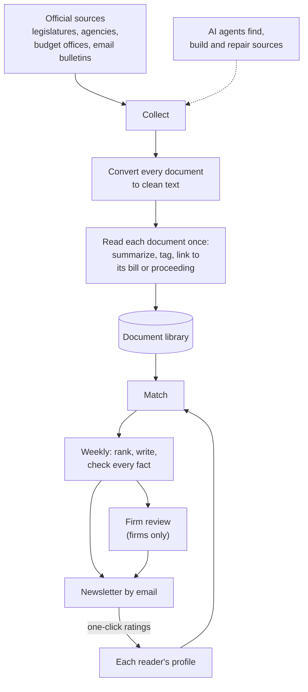

# Polletter

**One tailored weekly policy newsletter per reader, written from primary-source government documents.**

By **Adam Hatefi** · [Owrang Studios](https://owrang.io/studios/) · Live in private beta at [polletter.owrang.io](https://polletter.owrang.io)

> This is a showcase repository. It describes the product and how it is built; the source code is private and is not included here.

---

## What it is

Government publishes a huge amount every week: bills and their amendments, agency rules, hearing notices, budget analyses, comment periods. People whose jobs, communities or causes depend on that work either pay for an expensive tracking tool or miss most of it.

Polletter reads the official sources continuously and sends each reader **one email a week** covering what government did that affects *them*. Every item links back to the official document it came from.

The product is the newsletter. The data pipeline, the AI agents and the web app all exist to keep that newsletter accurate and relevant, and cheap enough to produce for one person at a time.

## Who it's for

| Reader | What they get |
|---|---|
| **Individuals** | "What government did this week that affects you", built from their job, community, state and interests. |
| **Organizations** (nonprofits, trade associations, companies) | An issue-area briefing for their staff, driven by their mission, issue areas and the bills and proceedings they watch. |
| **Lobbying and advocacy firms** | A weekly newsletter in the firm's own brand, for the firm's clients. The firm reviews, edits and approves each issue before it goes out under the firm's name. |

## How it works

1. **Collect.** Fetchers read official sources by whatever method each one offers: data feeds, bulk files, RSS, web pages and government email lists. AI agents find new sources and build the code that reads them. When a source changes shape, they notice and repair it.
2. **Convert.** Every document, including scanned PDFs and tables, becomes clean, structured text.
3. **Read once.** Each document is summarized, tagged and linked to the bill, docket or proceeding it belongs to. This happens once per document, never once per reader, which keeps costs low.
4. **Match.** Each reader's profile (job, location and legislative districts, issues, watched matters) is compiled once and matched against new documents as they arrive.
5. **Write and check.** Once a week, an AI writer assembles each reader's issue. A separate validation step checks every claim against the source before anything is sent. An item that fails is rewritten or left out.
6. **Learn.** Readers rate items with one click in the email, and those ratings shape the next week's issue.

## Principles it's built on

- **Primary sources only.** Every fact traces to an official government document or an organization's own publication, with a link. Commercial aggregators are never the source.
- **Facts come from the record, not from the AI.** Votes, dates and statuses are taken from structured government data. A model never supplies them.
- **No positions inferred by AI.** An organization's stance appears only when its own published statement says so.
- **Accuracy beats coverage.** A missed item is a gap; a wrong item destroys trust. No newsletter ships without passing validation.
- **Government content is treated as untrusted.** Public pages and comments can contain text that tries to steer an AI. Models that read ingested content have no tools and can only return structured answers.
- **A polite crawler.** It identifies itself honestly, respects robots.txt and rate limits, and never tries to get past a CAPTCHA. When it hits one, a person is asked to look instead.

## Built with

| Layer | Tools |
|---|---|
| Web app | Next.js (App Router, TypeScript), hosted on Netlify |
| Database, sign-in, storage, vectors | Supabase: Postgres with row-level security and pgvector |
| Background jobs and AI agents | Trigger.dev |
| Document conversion | Docling (Python) on Google Cloud Run |
| AI | Anthropic's Claude API and Claude Agent SDK; Voyage AI embeddings |
| Email, sending and receiving | Resend |
| Billing | Stripe |
| Monitoring | Sentry |
| Address to districts | U.S. Census Geocoder |

## How it's kept trustworthy

- **Written specification first.** A single specification is the source of truth for scope. Work runs in planned phases, and every shipped change is recorded with how it was proved.
- **Automated guards, each proven to catch what it guards against.** Beyond typechecks, linting and tests, the repository carries custom checks for the mistakes that matter here, such as a database table a browser could read when it shouldn't. Every guard comes with a harness that deliberately introduces the defect and confirms the guard fails.
- **Adversarial review.** Each batch of work gets an independent review from several angles before it ships.
- **Careful database changes.** Every database change is rehearsed on a local copy, checks itself when applied, and is tested read-only against production before it goes live.
- **Verified deploys.** Production deploys automatically once continuous integration passes, and each service is then read back to confirm it runs the expected version.
- **Privacy by design.** Every table is locked down by default. Private data lives in tables no browser can reach, and privileged actions run only on the server.

## Where it stands (November 2026)

- **Live in private beta.** Federal sources, plus California's legislature and state agencies.
- **Built so far:** the collection pipeline and its self-repairing source agents, profiles and matching, the newsletter engine with its validation gate, the web app for individuals, organizations and firms, and billing.
- **In progress:** organization positions and engagement opportunities, and [CredEngine](https://github.com/thartin/credengine-showcase), an optional add-on for organizations.
- **Next:** more states, then local governments.

---

### About this repository

This repository contains no source code. The Polletter name, product and code are proprietary.
Copyright © 2026 Adam Hatefi. All rights reserved.
Questions or a demo: [owrang.io/contact](https://owrang.io/contact/)
